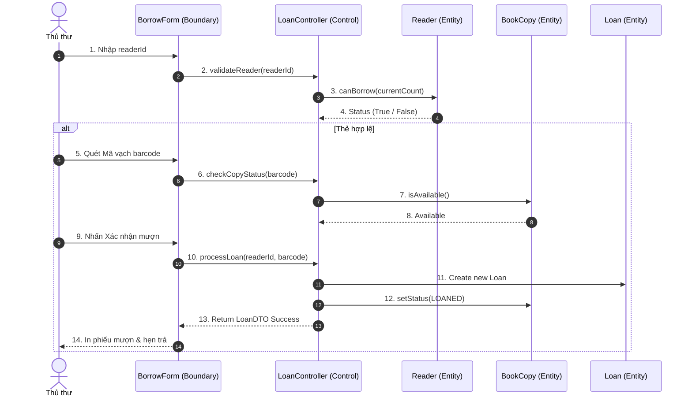
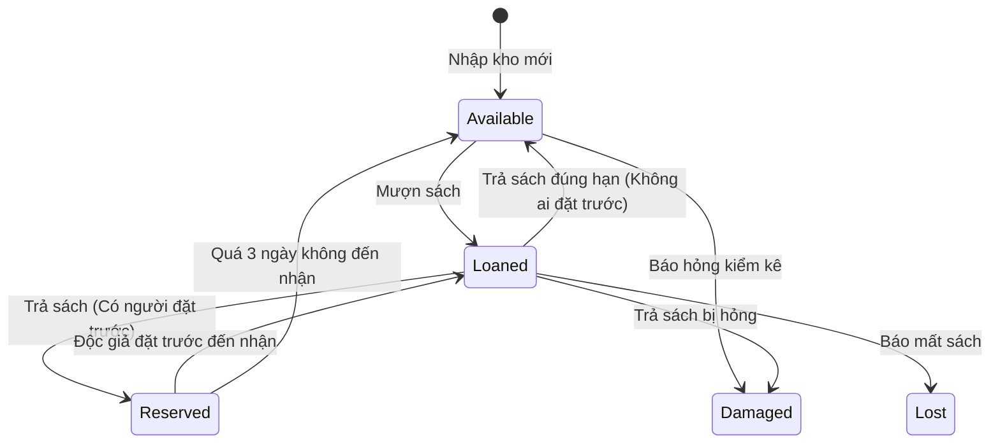

# ĐẶC TẢ CA SỬ DỤNG VÀ BIỂU ĐỒ TRÌNH TỰ (SEQUENCE DIAGRAMS)

## 1. ĐẶC TẢ UC21: LẬP PHIẾU MƯỢN SÁCH
- **Tác nhân:** Thủ thư (Chính), Độc giả (Phụ).
- **Mục tiêu:** Cho phép độc giả mượn các bản sao sách hợp lệ.
- **Tiền điều kiện:** Thủ thư đã đăng nhập; Độc giả có thẻ thư viện hợp lệ.
- **Luồng chính (Main Flow):**
  1. Thủ thư nhập/quét Mã độc giả (`readerId`).
  2. Hệ thống gọi `Reader.canBorrow(count)` kiểm tra điều kiện.
  3. Thủ thư quét Mã vạch bản sao (`barcode`).
  4. Hệ thống kiểm tra trạng thái `BookCopy.isAvailable()`.
  5. Hệ thống tự động tính `dueDate` (`borrowDate + readerType.maxBorrowDays`).
  6. Thủ thư xác nhận mượn.
  7. Hệ thống tạo bản ghi `LOANS`, đổi trạng thái bản sao thành `LOANED`, in phiếu mượn.
- **Ngoại lệ (Exceptions):**
  - Thẻ hết hạn / Nợ phạt > 50.000 VNĐ / Đã mượn tối đa -> Từ chối giao dịch.
  - Bản sao không ở trạng thái Available -> Báo lỗi.

## 2. ĐẶC TẢ UC22: TIẾP NHẬN TRẢ SÁCH & XỬ LÝ SỰ CỐ
- **Tác nhân:** Thủ thư.
- **Mục tiêu:** Ghi nhận trả sách, tính phí quá hạn/hỏng/mất và cập nhật lại trạng thái bản sao.
- **Luồng chính (Main Flow):**
  1. Thủ thư quét Mã vạch bản sao (`barcode`).
  2. Hệ thống truy vấn bản ghi `LOANS` đang mượn (`status = BORROWED`).
  3. Thủ thư chọn "Xác nhận trả bình thường".
  4. Hệ thống cập nhật `returnDate = NOW()`, đổi `LoanStatus = RETURNED`.
  5. Nếu có đơn đặt trước (`RESERVATION` dạng `Pending`): đổi trạng thái bản sao sang `Reserved` và gửi thông báo. Nếu không: đổi trạng thái sang `Available`.
- **Ngoại lệ (Exceptions):**
  - Trả trễ hạn: Kích hoạt tính tiền phạt = `số ngày trễ * 5.000 VNĐ`. Tự động tạo bản ghi `FINES` (`Unpaid`) và cộng vào `READERS.balance_fine`.
  - Sách bị hỏng/mất: Nhập mức bồi thường (100% - 200% `price`), chuyển trạng thái bản sao thành `Damaged` hoặc `Lost`.

## 3. SEQUENCE DIAGRAM (MERMAID) - CA SỬ DỤNG MƯỢN SÁCH

## 4. STATE MACHINE DIAGRAM - VÒNG ĐỜI BẢN SAO SÁCH (BOOK COPY)

